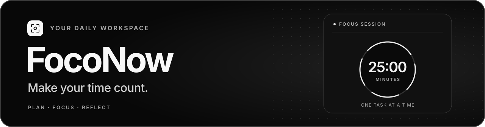
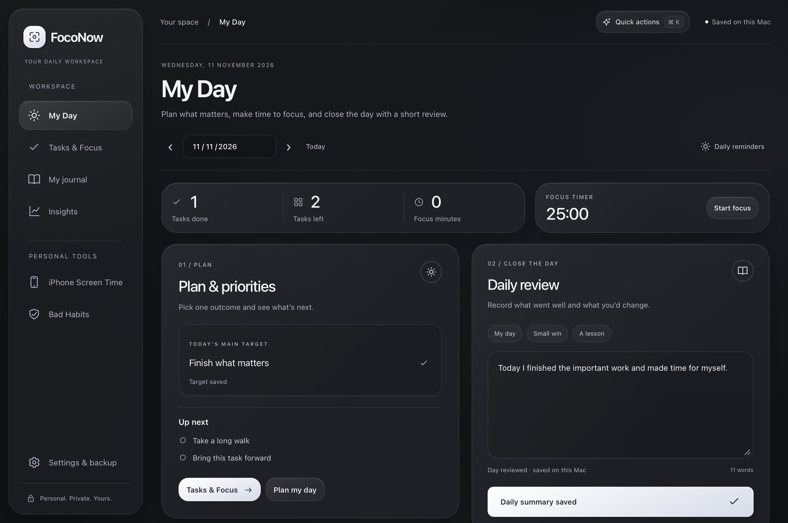
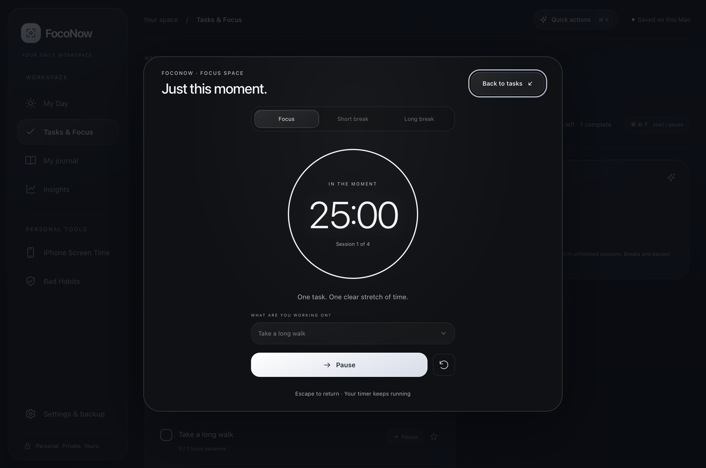
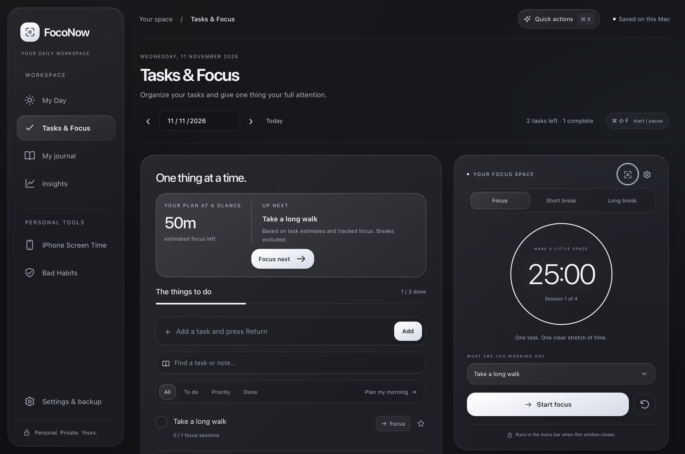
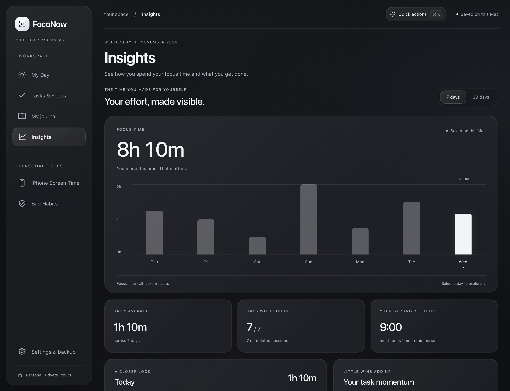

<h1 align="center">
  
</h1>

  A local-first workspace for planning your day, focusing on one task, and reflecting before you close the lid. 
  You can also review your iPhone Screen Time from your Mac.

  

<strong>Apple silicon</strong> · macOS 13 or later · Free preview

  <a href="https://mythosbrain.github.io/foconow-site/">Website</a> ·
  <a href="#install-on-mac">Install</a> ·
  <a href="#privacy-and-permissions">Privacy</a> ·
  <a href="#build-from-source">Build from source</a>

## New in 1.17

- **A glass workspace:** translucent panels, crisp controls, and balanced light and dark themes.
- **Plan at a glance:** estimated focus time left, with earlier work on carried tasks included.
- **Focus next:** start the first unfinished priority without searching your list.
- **Distraction-free focus:** a quiet timer view that stays in sync with the menu bar. Press Escape to return.

## Your daily workspace

| Workspace | What you can do |
| :--- | :--- |
| **My Day** | Set your main priority, plan your tasks, and bring unfinished work forward when you need it. |
| **Tasks & Focus** | See your estimated focus time left, start your next priority, and open a distraction-free timer. The timer keeps running in the menu bar when you close the main window. |
| **Journal & Insights** | Write a short daily review, then see where your focus time went and how your tasks progressed. |
| **Desktop widgets** | Check your timer, upcoming tasks, or a streak at a glance. Requires macOS 14 or later. |

**Bad Habits** and **iPhone Screen Time** are separate tools for tracking streaks and reviewing the phone activity already available on your Mac.

| Tasks & Focus | Insights |
| :---: | :---: |
|  |  |

*Screenshots show sample data.*

## Install on Mac

1. Download [FocoNow v1.17.0 for Apple silicon](https://mythosbrain.github.io/foconow-site/downloads/FocoNow-Mac-v1.17.0.dmg).
2. Open the DMG and drag **FocoNow.app** onto the **Applications** shortcut.
3. Launch FocoNow from Applications. Follow the welcome walkthrough or select **Skip setup** to open My Day.

This preview uses local signing. macOS may ask you to approve the app under **System Settings → Privacy & Security**. [Apple’s instructions for opening apps](https://support.apple.com/102445)

[Download page](https://mythosbrain.github.io/foconow-site/) · [Preview release notes](https://github.com/mythosbrain/foconow/releases/tag/v1.17.0)

## Privacy and permissions

FocoNow works offline and stores your plans, journal, and focus history on your Mac. Use **Settings & Backup** to export your plans, journal, and habit records to a file you choose. Pomodoro history is stored separately.

The core workspace works right away. The walkthrough explains each optional setting before you enable it.

| Optional setting | What it enables |
| :--- | :--- |
| **Notifications** | Timer completion alerts and scheduled reminders. |
| **Open at login** | Starts FocoNow when you sign in so the menu bar controls are ready. |
| **Accessibility** | Reads the iPhone Screen Time report you open in System Settings and lets you import past days. |
| **Full Disk Access** | Reads protected files for the alternative iPhone activity feed already synced to this Mac. |

Apple handles Screen Time syncing. FocoNow saves imported reports locally. **Read from Settings** captures the displayed total. The alternative activity feed can lag or contain partial data.

Preview the first-run walkthrough

## Build from source

On a Mac with Xcode or Apple Command Line Tools and Node.js installed, run the following from the repository root.

~~~bash
npm test
npm run check
bash scripts/build-mac.sh
~~~

To create the branded drag-to-install DMG, run `bash scripts/build-dmg.sh` after building the app. Its first run installs the pinned packaging tools into `releases/.dmg-tools`. The output includes a SHA-256 checksum beside the DMG.

The build bundles the offline web interface inside a native SwiftUI and WebKit app, signs it locally, and writes the app and ZIP to `releases/`. In Xcode, open `Apple/HabitCounter.xcodeproj` and select the `HabitCounterMac` scheme.

Version tags publish the verified DMG and its checksum through the repository’s release workflow. The manifest pins the installer to an immutable website commit; no personal access token is required.

For native verification, run `bash scripts/check-screen-time.sh` and `bash scripts/check-widgets.sh`. The project also includes an experimental iPhone target with [separate signing requirements](Apple/SCREEN-TIME-SETUP.md).
