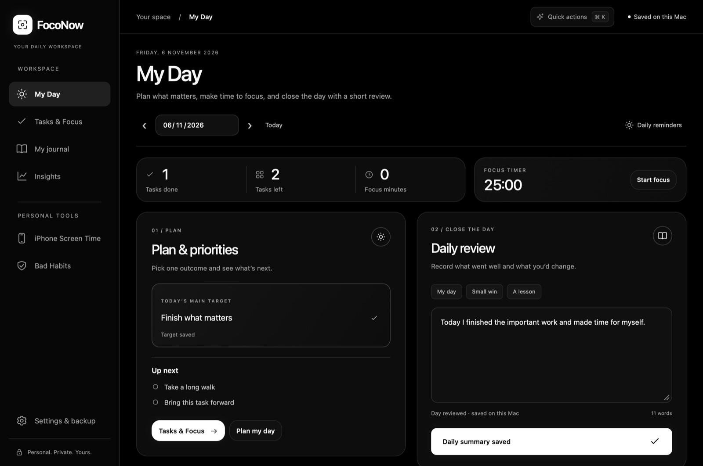
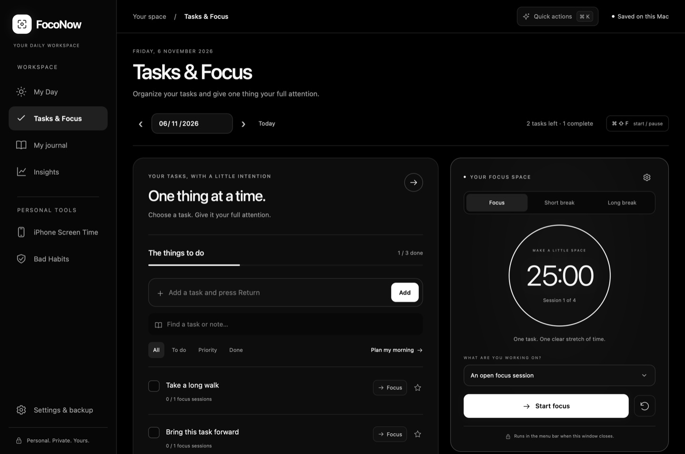
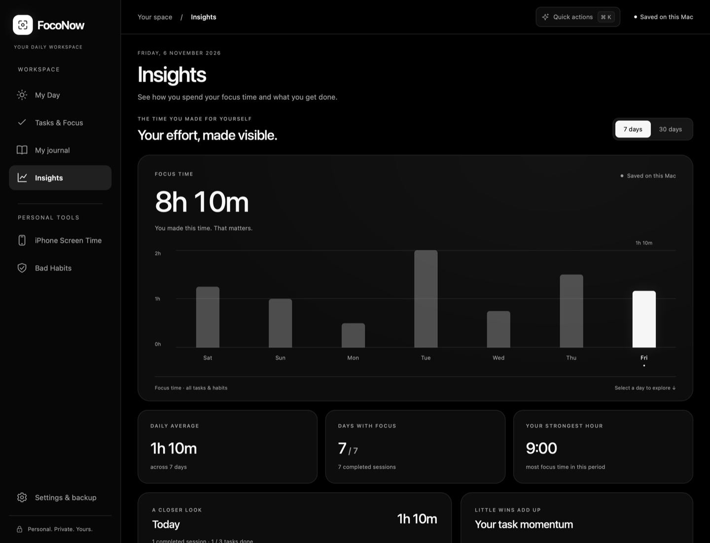
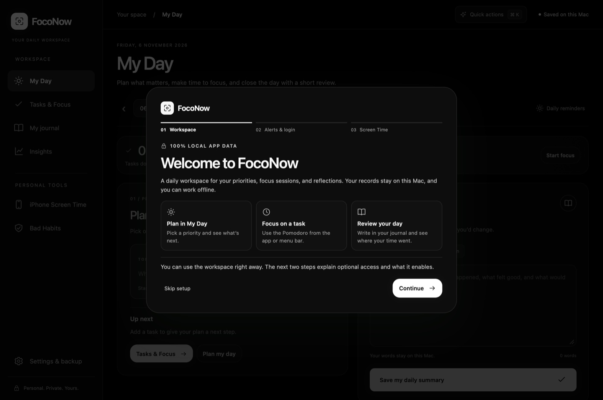

# FocoNow

**A private daily workspace for macOS.** Choose what matters, give it a block of focus, and record what you learned. Your plans, journal, track your iPhone screen time, and focus history stay on your Mac.

[Download for Mac](https://github.com/mythosbrain/foconow/releases/tag/v1.15.2) · [Build from source](#build-from-source) · [Privacy and permissions](#privacy-and-permissions)



## One place for your day

1. **Plan in My Day.** Pick a priority, add a few tasks, and bring unfinished work forward when you need it.
2. **Focus on one task.** Start a Pomodoro from the app or menu bar. Set your own focus and break lengths, and keep an eye on the clock with a desktop widget.
3. **Review your day.** Write a short reflection in your journal. In Insights, see how much focus time you logged and how it was distributed.

### Tasks & Focus

Add task notes, star priorities, and attach a focus session to a task. The timer keeps running when you close the main window.



### Insights

Review focus by day and task, and see how many planned tasks you completed. The separate **Bad Habits** tool tracks patterns and streaks. **iPhone Screen Time** can import reports already available on your Mac.



*Screenshots show FocoNow with sample records.*

## Install on Mac

1. Download `FocoNow-Mac-v1.15.2.dmg` from [the Mac preview release](https://github.com/mythosbrain/foconow/releases/tag/v1.15.2).
2. Open the disk image and drag **FocoNow.app** onto the **Applications** shortcut. Then open FocoNow from Applications.
3. Follow the welcome walkthrough or choose **Skip setup** to start using My Day.

The preview supports Apple silicon and macOS 13 or later. Desktop widgets require macOS 14 or later. The app is locally signed and may require approval in **Privacy & Security** because the preview has yet to be notarized by Apple. [Apple’s instructions for opening apps](https://support.apple.com/102445)

## Privacy and permissions

FocoNow stores your app data locally and works offline. Export a backup through **Settings & Backup** to save your plans, journal, and habit records to a file you choose. Pomodoro history is stored separately on your Mac.



The core workspace needs no additional access. The walkthrough explains each optional setting before you enable it.

| Option | What it enables |
| --- | --- |
| Notifications | Timer completion alerts and scheduled reminders. |
| Open at login | Starts FocoNow when you sign in so menu bar controls are ready. |
| Accessibility | Reads the iPhone Screen Time report you open in System Settings. |
| Full Disk Access | Lets FocoNow read protected files for the alternative synced iPhone activity source. |

Apple handles Screen Time syncing between devices. FocoNow reads what’s already on the Mac and saves imported reports locally. **Read from Settings** captures the displayed total. The alternative synced feed can lag or contain partial activity.

## Build from source

On a Mac with Xcode or Apple Command Line Tools and Node.js installed, run:

```sh
npm test
npm run check
bash scripts/build-mac.sh
```

Find the app and ZIP in `releases/`. The build bundles the local web interface in a native SwiftUI and WebKit app and signs it locally. In Xcode, use the `HabitCounterMac` scheme in `Apple/HabitCounter.xcodeproj`. The project also includes an experimental iPhone target with separate signing requirements.

For native checks, run `bash scripts/check-screen-time.sh` and `bash scripts/check-widgets.sh`.
